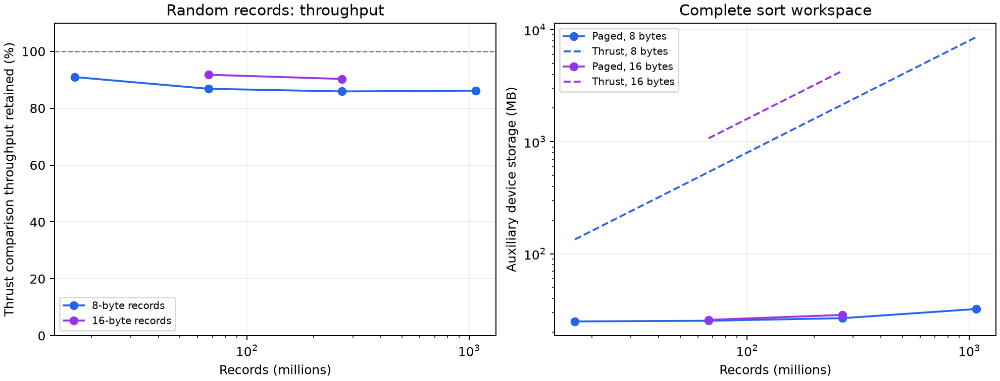

# Measured results

RTX PRO 6000 Blackwell Workstation Edition, 188 SMs; CUDA 12.9; CCCL 3.4.2.
9-trial medians after 5 warmups per algorithm. Recorded 2026-09-13T20:14:50.323910+00:00.

The strongest case is large comparison sorting of records. The complete output is returned to the original iterator range, including the final physical-page permutation.

| Records | Record bytes | Thrust scratch MB | Paged scratch MB | Thrust peak MB | Paged peak MB | Thrust ms | Paged ms | Thrust throughput retained | Scratch reduction |
|---:|---:|---:|---:|---:|---:|---:|---:|---:|---:|
| 16,777,216 | 8 | 134.25 | 24.91 | 268.47 | 159.13 | 2.61 | 2.87 | 91.0% | 81.44% |
| 67,108,864 | 8 | 537.00 | 25.26 | 1073.87 | 562.13 | 12.70 | 14.62 | 86.8% | 95.30% |
| 268,435,456 | 8 | 2148.01 | 26.63 | 4295.49 | 2174.12 | 57.98 | 67.49 | 85.9% | 98.76% |
| 1,073,741,824 | 8 | 8592.03 | 32.14 | 17181.97 | 8622.07 | 258.31 | 299.73 | 86.2% | 99.63% |
| 67,108,864 | 16 | 1074.00 | 25.71 | 2147.75 | 1099.46 | 27.20 | 29.63 | 91.8% | 97.61% |
| 268,435,456 | 16 | 4296.02 | 28.47 | 8590.98 | 4323.43 | 122.46 | 135.62 | 90.3% | 99.34% |

MB means 1,000,000 bytes. Peak memory is calculated as the input array plus measured scratch; it excludes CUDA runtime/context overhead and benchmark harness allocations. Throughput retained is `Thrust time / paged time`; 90% throughput is about 11% longer runtime.

## Refinement versus the initial prototype

The initial prototype is commit `a3df667d9`; its original nine-trial measurements and metadata are preserved in `original.csv` and `original-environment.json`. The table below compares those measurements with this implementation on the same GPU and CCCL version. These are separate benchmark runs, not interleaved original/refined trials.

The retained changes remove two full device-property queries, release single-tile inputs before allocating their output, bound the free queue by worker count, and share metadata between phases. Other transpose and register experiments did not give consistent enough gains to retain.

| Records | Record bytes | Initial ms | Refined ms | Runtime reduction | Initial scratch MB | Refined scratch MB |
|---:|---:|---:|---:|---:|---:|---:|
| 16,777,216 | 8 | 4.74 | 2.87 | 39.3% | 37.35 | 24.91 |
| 67,108,864 | 8 | 16.10 | 14.62 | 9.2% | 38.09 | 25.26 |
| 268,435,456 | 8 | 68.51 | 67.49 | 1.5% | 41.03 | 26.63 |
| 1,073,741,824 | 8 | 300.08 | 299.73 | 0.1% | 52.83 | 32.14 |
| 67,108,864 | 16 | 31.32 | 29.63 | 5.4% | 39.07 | 25.71 |
| 268,435,456 | 16 | 135.70 | 135.62 | 0.1% | 44.97 | 28.47 |

## Distribution sensitivity

Both algorithms use the same key-only comparator over records that also carry original positions and payloads. Ordered and separated runs can use page-map fast paths; their speedups should not be generalized to random data.

| Input, 67,108,864 records | Record bytes | Thrust ms | Paged ms | Speed relative to Thrust |
|---|---:|---:|---:|---:|
| random | 8 | 12.70 | 14.62 | 0.87x |
| duplicates | 8 | 12.55 | 14.48 | 0.87x |
| equal | 8 | 12.62 | 2.15 | 5.88x |
| sorted | 8 | 12.63 | 2.15 | 5.87x |
| reverse | 8 | 12.67 | 14.31 | 0.89x |
| runs | 8 | 12.62 | 3.02 | 4.17x |
| alternating | 8 | 12.66 | 4.19 | 3.02x |
| random | 16 | 27.20 | 29.63 | 0.92x |
| duplicates | 16 | 26.81 | 29.23 | 0.92x |
| equal | 16 | 26.50 | 3.21 | 8.27x |
| sorted | 16 | 26.51 | 3.21 | 8.27x |
| reverse | 16 | 26.64 | 28.73 | 0.93x |
| runs | 16 | 26.50 | 4.65 | 5.70x |
| alternating | 16 | 26.59 | 7.29 | 3.65x |

## Plain 32-bit keys

For 67,108,864 unsigned keys, the paged sort takes 7.82 ms with 12.87 MB of scratch. The explicit comparison baseline takes 5.79 ms, and the default Thrust radix baseline takes 1.66 ms. Retained throughput is 74.0% and 21.2%, respectively. This case does **not** meet the near-original-throughput target.

## Validation

- `correctness-final-8.txt`: PASS 1792 exact stable-sort comparisons
- `correctness-final-16.txt`: PASS 1792 exact stable-sort comparisons
- `correctness-stress.txt`: PASS 74 guarded/concurrency/default-comparator stress cases
- `memcheck-final.txt`: 3 configurations; ERROR SUMMARY: 0 errors
- `initcheck-final.txt`: 3 configurations; ERROR SUMMARY: 0 errors
- `racecheck-final.txt`: 3 configurations; RACECHECK SUMMARY: 0 hazards displayed (0 errors, 0 warnings)
- `synccheck-final.txt`: 3 configurations; ERROR SUMMARY: 0 errors

Tests compare 8- and 16-byte records exactly with CPU `std::stable_sort`, covering ascending/descending comparators, duplicate/ordered/adversarial inputs, tails, every supported page size, and empty inputs. Separate stress cases exercise guarded subranges, worker counts from 1 to 1,024, workspace reuse, a non-default stream, and signed-zero stability. Large benchmark outputs are additionally compared exactly with Thrust.

Each sanitizer covers early release with 8- and 16-byte records and the multi-tile release path, all with partial pages. Sanitizer timing is instrumentation overhead and is not used in the performance tables. Sanitizers cover the specified finite cases, not all possible schedules or global-memory interleavings.

## Measurement boundaries

- Both sorts use reusable scratch buffers, so allocation growth is outside timed trials. CUDA event intervals include the complete sort, including setup kernels, merge levels, and final materialization. Each input is reset outside its timed interval; run order alternates.
- The baseline's custom allocator records its complete temporary allocation. The paged implementation uses one allocation containing all data pages, maps, counts, queue storage, locks, and counters. Scratch figures exclude the input array; peak figures add its size to the scratch allocation.
- The harness also retains a pristine input copy and reference output for resetting/verifying both implementations. Those harness allocations are excluded equally and are not required by the paged algorithm.
- Each size/distribution uses a deterministic input; timings are repeat trials of that input, not independent random datasets. No GPU clocks or power limits were changed. Hardware/version generality has not been established.
- Small and medium inputs are slower and can use more scratch than ordinary Thrust because of the hardware-sized spare reserve. The report does not claim a universal replacement for all stable-sort workloads.

Raw data: `final.csv`, `scalar-final.csv`. Reproduction metadata and exact source hashes: `environment.json`. Build, validation, and benchmark commands are in the parent README.
